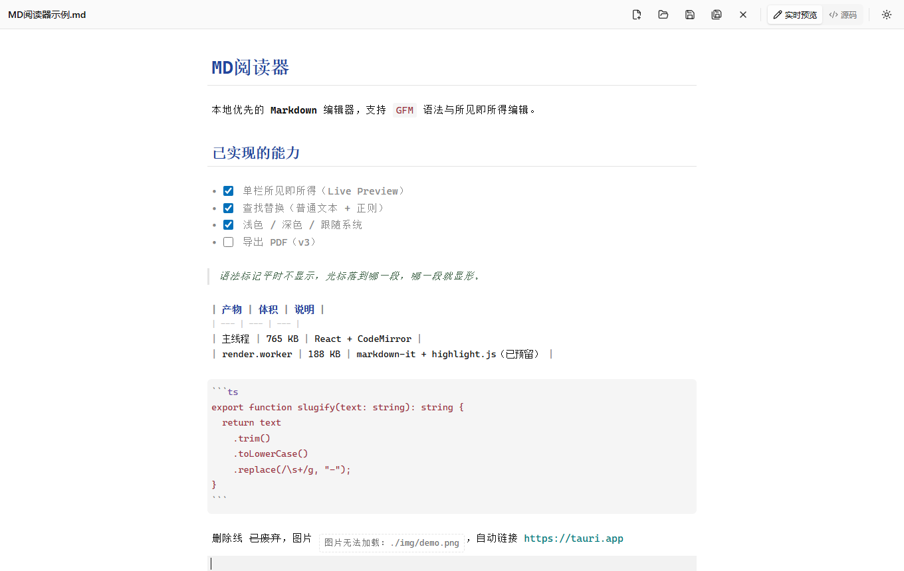
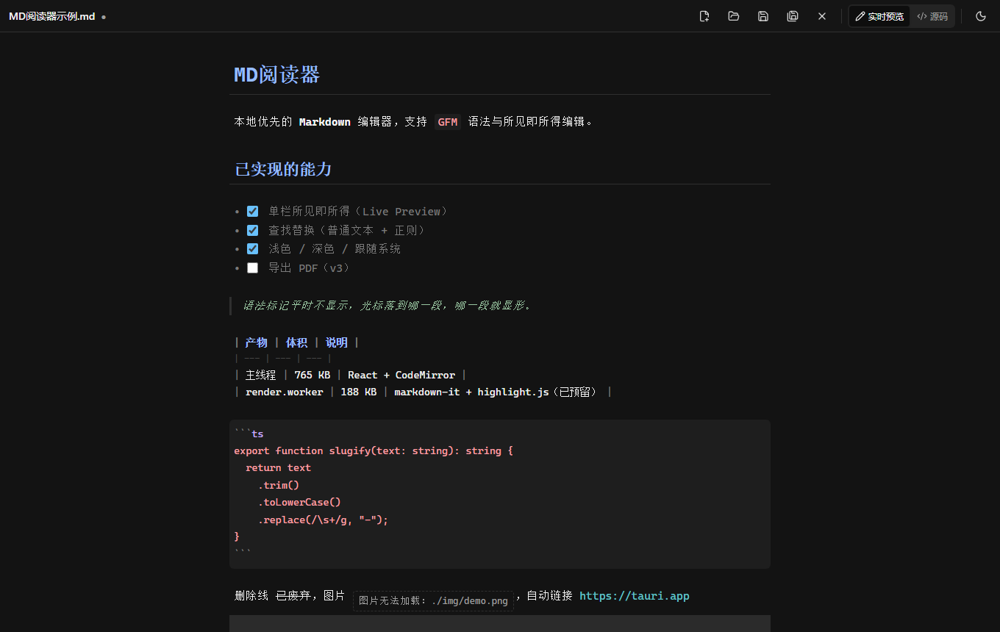
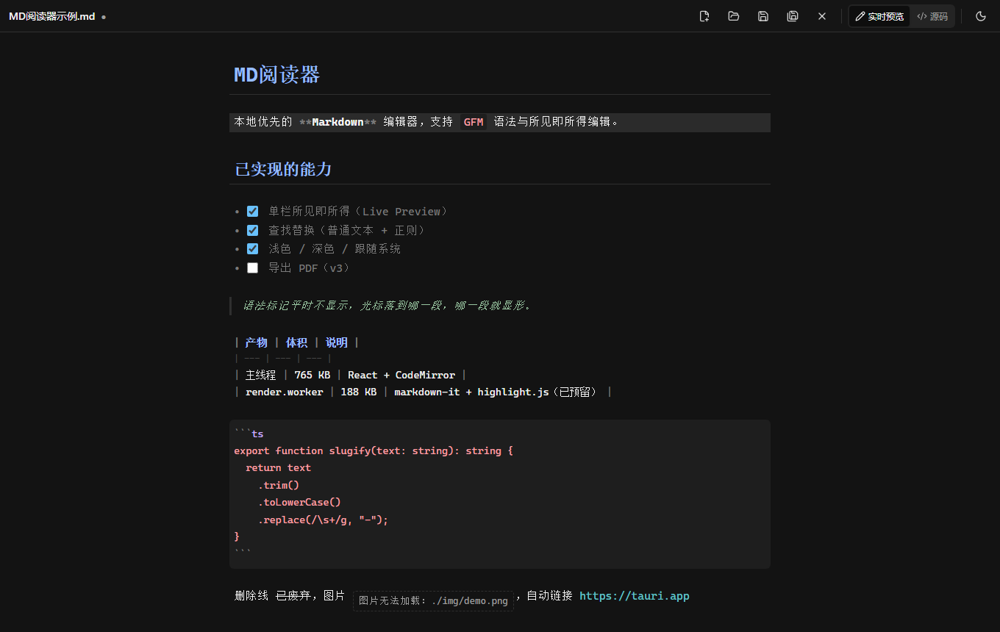
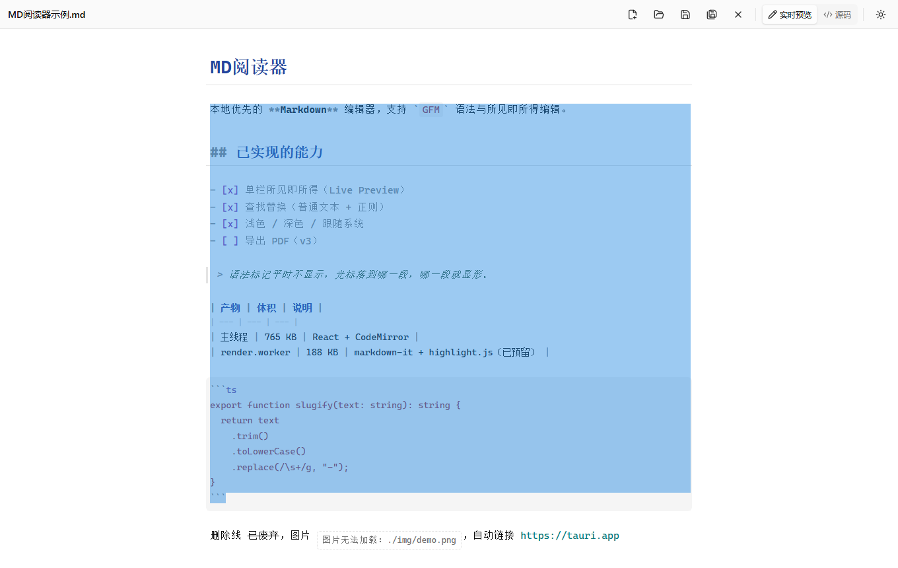
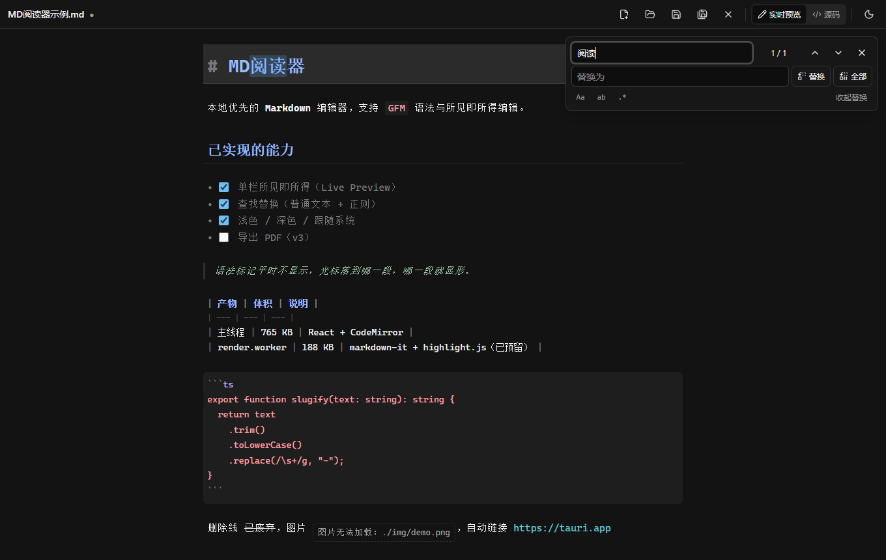
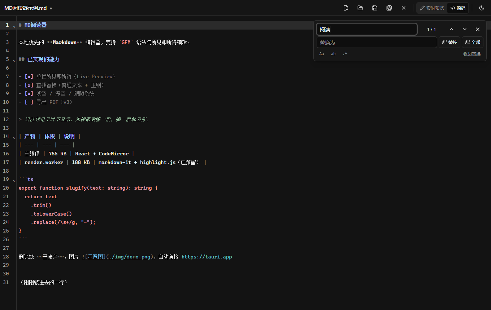

# MD阅读器

面向 **Windows** 的本地优先 Markdown 编辑器。不收集数据、不联网、双击即用。

编辑方式是 **Typora 式的单栏所见即所得**：语法标记平时藏起来，光标落到哪一段，哪一段的标记才现形。
同一栏里既能直接读，也能直接改，不需要在「编辑」和「预览」之间来回切。



---

## 功能

### 编辑

- **单栏所见即所得**（Live Preview）：标题、加粗、斜体、删除线、行内代码、链接、引用、
  有序/无序列表、任务列表（勾选框可直接点）、表格、代码块、分隔线、图片，全部有对应样式
- **两条豁免规则**决定手感：块级标记（`#` `>` `-` `[ ]`）按**行**豁免 —— 光标进这一行，整行标记显形；
  行内标记（`**` `` ` `` `[..](..)`）按**元素**豁免 —— 光标只进加粗那一小段，同一行的行内代码反引号仍然藏着
- **源码模式**：`Ctrl+/` 双向切换，标记回到原样
- 拖选可见的选区（不透明背景不会盖住它）、撤销/重做

> 刻意保留：代码围栏 ` ``` ` 与表格的 `|` 不隐藏。
> 把它们藏掉之后，「想改代码块的语言」和「想调整表格列宽」都变得很难点中，得不偿失。

### 文件

- 新建 / 打开 / 保存 / 另存为 / 关闭：`Ctrl+N` `Ctrl+O` `Ctrl+S` `Ctrl+Shift+S`
- **未保存改动保护**：新建、打开、关闭、拖拽、文件关联打开之前统一问一次。
  弹不出原生确认框时**挡住并提示**，绝不静默丢内容
- **拖拽打开**：拖 .md 到窗口即可
- **文件关联**：安装后双击 `.md` / `.markdown` 直接打开；应用已运行时双击第二个文件会转发给
  现有窗口，不会开出第二个进程
- 最近文件列表（可单条移除）

### 导出

- **导出为独立 HTML**：工具栏「导出 HTML」按钮。产物是**单个自包含文件** ——
  双击能在任何浏览器里打开、排版与实时预览一致、不依赖任何外部资源。
  正文走同一条渲染管线（markdown-it + highlight.js → DOMPurify），
  样式从当前样式表里按选择器挑出来内联（只挑颜色令牌 / `.markdown-body` / `.hljs`），
  而不是在 TS 里另写一份 —— 手写一份迟早和应用里的样式漂移。
  导出不改变当前文档，所以**不弹**「放弃未保存改动」确认。
- 相对路径的图片会被写成相对路径 `src`：把 `.html` 和图片放在一起就能正常显示。

### 查找替换

`Ctrl+F` 唤起自研中文面板（不用 CodeMirror 自带的英文面板）：

- 普通文本 / **正则表达式** / 区分大小写 / 全词匹配
- 替换当前、**全部替换**（一次 `Ctrl+Z` 可整体撤销）
- 匹配数上限保护 + 正则语法错误明确提示

### 外观

- 浅色 / 深色 / **跟随系统** 三态循环
- 首屏防闪白：`public/theme-init.js` 在样式表之前同步执行
- 配色全部走 CSS 变量，切主题只翻 `<html>` 上的一个 class

### 状态栏与窗口标题

- 底部状态栏：**字数 / 字符数 / 行数 / 已选字符数**，右侧是编码（UTF-8 / UTF-8 BOM）、
  换行符（LF / CRLF / CR）、当前视图模式、光标行列
- 字数口径与 Word / 微信一致：**中日韩逐字**、**西文按词**（`well-known` 算一个词）。
  字符数按 **Unicode 码点** 计，`😀` 算 1 而不是 2
- 窗口标题跟随当前文档（`● 文件名 — MD阅读器`，`●` 表示有未保存改动）

### 界面

| 实时预览 | 深色 + 未保存标记 |
| --- | --- |
|  |  |

| 光标所在行标记显形 | 拖选 |
| --- | --- |
|  |  |

| 查找替换 | 源码模式 |
| --- | --- |
|  |  |

---

## 技术栈

| 层 | 选型 |
| --- | --- |
| 外壳 | Tauri v2（Rust 1.90+） |
| 界面 | React 19 + TypeScript 6（strict） |
| 编辑器 | CodeMirror 6 |
| 样式 | Tailwind v4 |
| 状态 | Zustand |
| 渲染管线 | markdown-it + highlight.js + DOMPurify（Web Worker，按需加载） |

---

## 开发

前置：**Node 22+**、**pnpm**、**Rust 1.90+**、WebView2 运行时。

```bash
pnpm install
pnpm tauri dev        # 开发模式，热重载
```

### 构建

**就用这一条**，它会自己 `pnpm build` 并把前端资源内嵌进 exe：

```bash
pnpm tauri build --no-bundle
# 产物：src-tauri/target/release/md-reader.exe
```

手敲 cargo 也可以，但**必须带 `--features custom-protocol`**：

```bash
pnpm build            # 前端 → dist/
cd src-tauri && cargo build --release --features custom-protocol
```

> ⚠ **`--features custom-protocol` 绝对不能省。**
> Tauri v2 靠这个 feature 区分开发/生产：开着才会把 `frontendDist` 里的前端资源**内嵌进 exe**；
> 没开就会保留 `devUrl`，运行时去连 `http://localhost:1420` ——
> 直接双击 exe 会得到「localhost 拒绝连接」。
> `tauri build` 会自动带上，手敲 `cargo build --release` 不会。
>
> 判据（不必连 GUI 就能认出来）：产物跑起来后地址栏/`win.url()` 是
> `http://tauri.localhost/` → 生产；是 `http://localhost:1420/` → 编漏了 feature。

### 打安装包

```bash
pnpm tauri build      # 产出 NSIS 安装包，并注册 .md 文件关联
```

---

## 架构

```
src/
├── App.tsx              外壳：全局快捷键 / 拖拽 / 文件关联 / 窗口标题 / 布局编排，不写业务逻辑
├── components/
│   ├── Editor.tsx       CodeMirror 装配、视图模式切换、编辑区主题、上报光标
│   ├── Toolbar.tsx      工具栏
│   ├── StatusBar.tsx    底部状态栏（字数 / 编码 / 换行 / 光标）
│   ├── FindReplace.tsx  查找替换面板
│   ├── Welcome.tsx      欢迎页 / 最近文件
│   └── Preview.tsx      渲染管线宿主（当前无 UI 入口，见下）
├── lib/
│   ├── live-preview.ts  ★ 所见即所得的核心：三类装饰 + 分派 + 拖选冻结
│   ├── fs.ts            所有文件操作的唯一出口（含原生对话框）
│   ├── export-html.ts   导出独立 HTML：拼文档 / 图片补全 / 按选择器提取样式
│   ├── status-metrics.ts      字数 / 字符 / 行数的纯函数（规则集中在这里）
│   ├── cursor.ts        光标位置的极小外部订阅（配合 useSyncExternalStore）
│   ├── markdown-parse.ts      markdown-it + highlight.js，只允许 Worker 引用
│   ├── markdown-sanitize.ts   DOMPurify 清洗，主线程唯一入口
│   ├── markdown-path.ts       纯字符串路径工具，两侧共用
│   ├── recent.ts / highlight.ts / utils.ts
│   └── worker/render.worker.ts
├── store/editor.ts      文档状态（不含 EditorView 实例，也不含光标）
└── hooks/useTheme.ts    主题三态

src-tauri/src/
├── lib.rs               入口：插件注册、启动参数解析
└── commands/
    ├── file.rs          read_file / write_file / path_exists / allow_asset_dir
    └── launch.rs        文件关联带来的路径（冷启动 State + 单实例事件转发）
```

几条硬约束：

- **文件操作只能从 `src/lib/fs.ts` 出**，Rust 侧只能从 `src-tauri/src/commands/` 出
- 编辑区扩展列表在 `EditorState.create` 时固定，**切视图模式必须重建 EditorView**（滚动位置手动接回）
- `EditorView` 实例**不进 zustand**，走 `Editor.tsx` 的 `getActiveEditorView()` 单槽注册表
- 严格 CSP、不使用任何外部 CDN、外链一律交系统浏览器打开，不在 WebView 内导航
- 关键路径必须明确报错，**不允许静默失败**

---

## 验收

`dev/` 与 `vite.verify.config.ts` 是 **dev-only**，不进正式构建。六套件共 **282 条**断言：

| 套件 | 条数 | 覆盖 |
| --- | --- | --- |
| `verify.html` | 47 | 渲染管线（解析 / 清洗 / 图片重写） |
| `verify-editor.html` | 34 | 编辑器 + 渲染管线端到端 |
| `verify-app.html` | 95 | 界面、快捷键、视图模式、装饰层 |
| `verify-selection.mjs` | 18 | 拖选准确性、选区可见性（真实像素）、层叠顺序、拖选后删除 |
| `verify-status.html` | 35 | 字数口径逐条、状态栏接线、光标同步、窗口标题 |
| `verify-export.html` | 53 | 导出文档拼装、图片地址补全、样式提取的取舍、iframe 真渲染 |

```bash
# 1. 构建验证产物并起服务
pnpm exec vite build --config vite.verify.config.ts
pnpm exec vite preview --config vite.verify.config.ts --port 4173 --strictPort --host 127.0.0.1

# 2. 逐个跑（连跑会撞超时）
node dev/verify-runner.mjs http://127.0.0.1:4173/dev/verify.html
node dev/verify-runner.mjs http://127.0.0.1:4173/dev/verify-editor.html
node dev/verify-runner.mjs http://127.0.0.1:4173/dev/verify-app.html
node dev/verify-runner.mjs http://127.0.0.1:4173/dev/verify-status.html
node dev/verify-runner.mjs http://127.0.0.1:4173/dev/verify-export.html
node dev/verify-selection.mjs http://127.0.0.1:4173

# 3. Rust 侧单测
cd src-tauri && cargo test --release
```

另有 `Rust 单测` 覆盖启动参数解析（`cargo test --release`，13 条）。
截图：`node dev/screenshot.mjs http://127.0.0.1:4173 docs/screenshots`

### 几条验收经验

- 断言一律走 **DOM / 真实像素**，不要用正则扫 HTML 字符串（会误报）
- **色值 ≠ 可见性**：元素颜色、位置、opacity 全对，照样可能被上层不透明背景盖住。
  确认「看不看得见」必须截图读像素
- 测拖选必须用 CDP 派发**真实鼠标事件** —— 页面内 `dispatchEvent(new MouseEvent(...))`
  不会触发 pointer 事件链，测出来永远是「选不中」的假象
- **程序性改选区不会触发 DOM 的 `selectionchange`**。要观测光标，必须挂 CodeMirror 的
  `updateListener`（每次选区变化都产生事务）；靠 DOM 事件的话，
  「查找替换选中匹配项」这类操作会让状态栏静默停在上一次的位置
- `useSyncExternalStore` 的 `getSnapshot` **必须返回缓存引用**：每次给新对象会被判定
  "外部状态变了" → 重渲 → 再读 → 无限循环。所以写入侧要做值比较，没变就不通知
- **Chrome 把 `oklch()` 的计算值序列化成 `lab(...)` / `oklab(...)`**，不是 `rgb()`。
  想从 `getComputedStyle` 里解析出通道值再算亮度是行不通的（第五套件的第一版就栽在这）。
  要判「深浅两版底色不同」，直接比较**计算后的颜色字符串是否相等**，别去解析颜色值。
- **「字符串里有这行 CSS」不等于「这行 CSS 有用」**：选择器写错、变量没定义、
  被后面的规则覆盖，字符串断言全都是绿的。导出这类产物要**塞进 iframe 真渲染一遍**
  再读 `getComputedStyle`（srcdoc 被当作同源，dev 的 CSP 放行内联样式）。

---

## 当前未实现

| 类别 | 缺什么 |
| --- | --- |
| 导出 | 导出 PDF、打印 |
| 编辑增强 | **编辑区实时预览里的代码块没有语法高亮**（highlight.js 只接在渲染管线里）、表格可视化编辑、图片粘贴上传 |
| 交互 | 实时预览模式下链接**点击不跳转**（只上色，需切源码模式或走渲染管线） |
| 规模 | 多标签页、文件树 / 侧栏、大纲（`toc` 已在渲染管线里产出，差 UI）、命令面板、跨文件全文搜索 |
| 扩展语法 | KaTeX 公式、Mermaid 图表 |
| 其它 | 自动保存、外部文件变更监听 |

> 渲染管线（markdown-it + highlight.js + DOMPurify）代码完整保留、47 条断言覆盖，
> 但主界面目前**没有 UI 入口** —— 上面的「导出 / 打印 / 独立预览窗口」都要复用它，
> 所以 `src/components/Preview.tsx` 请勿删除。

---

## 本机环境备忘

这台机器上开发会撞到的几个坑，记下来省得重复踩：

- `pnpm` 必须在 `pnpm-workspace.yaml` 里设 `nodeLinker: hoisted`
- 不要用 `vite dev` 做验收：预构建阶段要删 `.vite/deps_temp_*`（超过 50 个文件）会被批量删除保护拦下，
  dev server 直接崩。一律走生产构建 + `vite preview`
- `vite preview` 默认只监听 `[::1]`，而 Chrome 把 `localhost` 解析到 IPv4 ——
  验收时显式 `--host 127.0.0.1` 并用 `http://127.0.0.1:4173`
- 本机若有 `http_proxy` 环境变量会拦本地请求：curl 加 `--noproxy '*'`，
  跑验收脚本前 `unset http_proxy https_proxy HTTP_PROXY HTTPS_PROXY`
- `src-tauri/target` 会涨到 **5 GB 以上**（debug 4.1 G + release 1.6 G）。
  只跑 release exe 的话可以删掉 `target/debug` 回收 4 G：
  ```bash
  rm -rf src-tauri/target/debug
  ```
- **重建 exe 前必须确认应用没在运行**，否则 cargo 报
  `LNK1104: 无法打开文件 …\deps\md_reader.exe`。
  两个容易踩的点：
  1. `target/release/md-reader.exe` 与 `deps/md_reader.exe` 是 cargo 的**硬链接**，
     是同一个文件 —— 按 `md_reader`（下划线）去找占用者会一无所获，进程名其实是
     `md-reader`（连字符）。
  2. 应用被强行关闭时可能留下**僵尸进程**（父进程已退出），
     `taskkill /T /F` 会报「没有此任务的实例在运行」。
     改用 WMI：
     ```powershell
     Get-CimInstance Win32_Process -Filter "ProcessId=<PID>" | Invoke-CimMethod -MethodName Terminate
     ```
- `cargo` 不在默认 PATH 里，且 `tauri build` 需要它：
  `export PATH="$HOME/.cargo/bin:$PATH"`（否则报 `cargo metadata ... program not found`）
- 本机 cargo 走 rsproxy 镜像，直连会被无端口的代理环境变量掐断。
  构建前显式给带端口的代理：
  ```bash
  export CARGO_HTTP_PROXY=http://127.0.0.1:5391
  ```
- **🔴 本机 WebView2 的 GPU 进程会沙箱崩溃**（2026-10 实测）：
  `GPU process exited unexpectedly: exit_code=7` 连崩 6 次后
  `FATAL: gpu_data_manager_impl_private.cc: GPU process isn't usable. Goodbye.`
  直接**中止 browser 进程** —— 整个 webview 存活不到 3 秒，表现就是窗口一片空白。
  `--disable-gpu` / `--disable-gpu-compositing` / `--use-angle=swiftshader` 都**无效**
  （现代 Chromium 即使禁用 GPU 也照样起 GPU 进程）；
  `--disable-gpu-sandbox` 或 `--no-sandbox` 可解。
  项目已在 `tauri.conf.json` 里固定 `--disable-gpu-sandbox`（见下面的 `additionalBrowserArgs` 说明）。
- **`additionalBrowserArgs` 是「替换」不是「追加」**：wry 0.57.0
  `webview2/mod.rs:300` 写的是 `unwrap_or_else`，一旦设置这个字段，
  wry 自己的默认值就被丢掉，必须原样抄回来：
  ```jsonc
  "additionalBrowserArgs": "--disable-features=msWebOOUI,msPdfOOUI,msSmartScreenProtection --disable-gpu-sandbox"
  ```
- 调试 release 版 webview 用**环境变量**最省事，不用改配置也不用重编：
  ```bash
  WEBVIEW2_ADDITIONAL_BROWSER_ARGUMENTS="--remote-debugging-port=9223" ./md-reader.exe foo.md
  curl --noproxy '*' http://127.0.0.1:9223/json/list
  ```
  这条通道和 `additionalBrowserArgs` 是**叠加**的（实测 `--enable-logging` 生效）。
  但要记住：**端口得等浏览器进程活过 3 秒**才连得上 —— 被 GPU FATAL 干掉时是连不上的。
- Chromium 自身的错误日志落在 `%LOCALAPPDATA%\com.tingyumian.mdreader\EBWebView\chrome_debug.log`，
  排查「白屏」先看它，比猜快得多。
